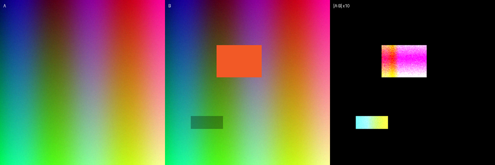

# vision-eval

[](https://github.com/slowpoke-flex/vision-eval/actions/workflows/tests.yml)

**Numbers first, pixels last.** A small, framework-agnostic skill and CLI for evaluating computer-vision
outputs: image diffs, segmentation masks, depth maps, and the contact sheets that make a failure obvious
as a ~250-token JSON report instead of thousands of image tokens.

Built and maintained by **Mind Space Studio**. MIT.



[English](README.md) · [简体中文](README.zh-CN.md) · [Русский](README.ru.md)

## Why

Agents and humans both cheat when they look at one attractive sample. A vision review needs a metric, a
sample size and the command that produced it. This tool gives an agent that first pass in one call:

- **image / render diff** — PSNR, SSIM, MAE, RMSE, changed %, connected error regions (line / blob / speck);
- **segmentation** — IoU, Dice, precision, recall per class;
- **depth** — AbsRel, RMSE, δ1/δ2/δ3;
- **contact sheet** — A | B | amplified diff, so the eye checks what the numbers found;
- **exit codes** — fail CI when a threshold is crossed.

It does not train models, host datasets or replace a held-out test set. It makes the first pass cheap and honest.

## Why it saves tokens

Every image an agent "looks at" costs roughly `width × height / 750` tokens on Claude (capped around
1.6k per image). Comparing two renders means paying for both. vision-eval returns the verdict as a short
JSON report instead, and you open the contact sheet only when a threshold fails.

| Image pair | Send A + B to the model | vision-eval JSON | Savings |
|------------|------------------------:|-----------------:|--------:|
| 1920×1080  | ~3,200 tokens           | ~270 tokens      | **~12×** |
| 1024×1024  | ~2,800 tokens           | ~220 tokens      | **~13×** |
| 256×256    | ~170 tokens             | ~220 tokens      | none — just send the images |

Reproduce on your own files: `python examples/token_budget.py A.png B.png`. Numbers are estimates
(image formula from Anthropic docs, JSON counted with a proxy tokenizer); savings multiply with every
pair an agent would otherwise inspect.

## Quickstart

Requires Python ≥ 3.10; dependencies are just `numpy` and `Pillow`.

```bash
git clone https://github.com/slowpoke-flex/vision-eval.git
cd vision-eval
python -m pip install -e .
python examples/make_examples.py

vision-eval diff examples/a.png examples/b.png --json report.json --sheet sheet.png
vision-eval mask examples/mask_pred.png examples/mask_gt.png --classes 1
vision-eval depth examples/depth_pred.npy examples/depth_gt.npy
```

If the `vision-eval` script is not on PATH, use `python -m vision_eval` with the same arguments.

Example output:

```json
{
  "mae": 0.015852,
  "rmse": 0.080293,
  "psnr_db": 21.906,
  "ssim": 0.96038,
  "changed_pct": 6.866,
  "regions": [{"kind": "blob", "area": 3500, "box": [80, 70, 149, 119], "peak": 0.6588}]
}
```

## Commands

| Command | What it does | CI gate |
|---|---|---|
| `vision-eval diff A B` | image/render metrics + regions + optional sheet | `--min-psnr 38` |
| `vision-eval mask PRED GT` | per-class IoU/Dice/precision/recall | `--min-iou 0.8` |
| `vision-eval depth PRED GT` | AbsRel/RMSE/δ, optional scale | `--max-absrel 0.1` |

All commands print JSON; `--json PATH` writes it, `--sheet PATH` writes the visual. Exit code is `0` on pass,
`1` on a failed threshold, `2` on an input error.

## Agent skill

`SKILL.md` is the reusable instruction set for Claude Code, Codex, OpenCode, Cursor and any agent that can
read a file and run a command. Copy it into the agent's skill directory; the CLI is optional but recommended.

- **Claude Code:** copy this folder to `~/.claude/skills/vision-eval/`.
- **Codex / OpenCode:** add the `SKILL.md` body to `AGENTS.md`, or reference it from a card.
- **Cursor:** copy `docs/integrations/cursor.md` into `.cursor/rules/vision-eval.mdc`.
- **Any MCP client:** see `docs/integrations/mcp.md` for a thin wrapper around the CLI.
- **GitHub Actions:** see `docs/integrations/github-actions.md`.

## Metrics, briefly

The CLI computes image, segmentation and depth metrics. The other rows are a reference
for choosing metrics and are **not implemented yet**.

| Task | Primary | Secondary |
|---|---|---|
| Image / render | PSNR, SSIM, MAE | FLIP, changed % |
| Segmentation | IoU, Dice | boundary F, per-class IoU |
| Detection | mAP@IoU, precision/recall | AP by class/size |
| Depth | AbsRel, RMSE | δ1/δ2/δ3 |
| Optical flow | EPE | outlier %, flow map |
| Keypoints | PCK, NME | per-joint error |

Never compare metrics computed with different resize, crop, colour space or normalization. State them.

## What it does not do

- It is not a benchmark leaderboard.
- It does not decide whether an image is beautiful.
- It does not replace human review for subjective quality.
- It does not hide a bad sample behind an average.

## Docs

- [SKILL.md](SKILL.md) — agent rules and workflow.
- [examples/README.md](examples/README.md) — synthetic inputs and commands.
- [docs/github-topics.md](docs/github-topics.md) — discovery topics.
- [LAUNCH.md](LAUNCH.md) — how to distribute it honestly.
- [中文说明](README.zh-CN.md) · [Русская инструкция](README.ru.md)

## License

MIT © 2026 Mind Space Studio. See [LICENSE](LICENSE).
