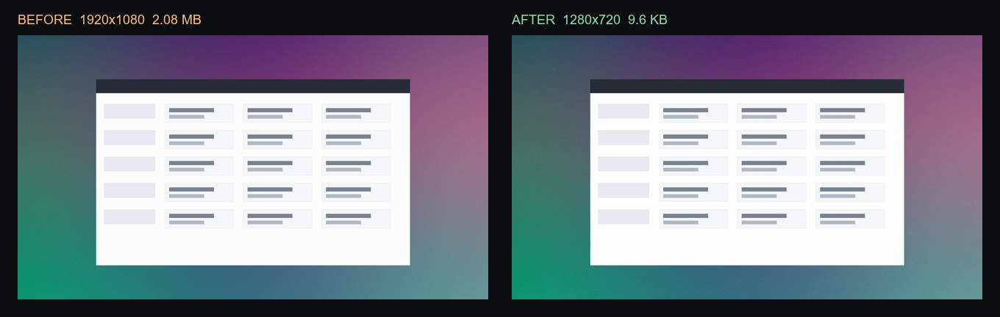

# pixel-diet

[](https://github.com/slowpoke-flex/pixel-diet/actions/workflows/tests.yml)

**Most of a screenshot is not information.** A 1920×1080 image costs a vision model about 2,765 image
tokens — and the empty margins, the wallpaper and the compression noise cost exactly as much as the button
you asked about.

`pixel-diet` is a small Python library and CLI that crops, resizes and re-encodes an image **before** it
reaches GPT-4o, Claude, Gemini or a local Qwen-VL. Named presets instead of fifteen thresholds. The same
package turns image comparisons into numbers, so an agent can skip the picture entirely when a metric
already answers the question.

Built and maintained by **Mind Space Studio**. MIT.

[English](README.md) · [简体中文](README.zh-CN.md) · [Русский](README.ru.md)

## What it saves (measured, not promised)

Five synthetic inputs, generated by `examples/shrink_demo.py` and measured on this laptop
(Windows 11, Python 3.14, Pillow 13.0.0, 2026-10-26):

| Input | Preset | Pixels | Bytes | Est. image tokens |
|---|---|---|---:|---:|
| flat UI, solid frame | `ui-agent` | 1920×1080 → 1280×678 | 9,811 → 8,152 (−16.9%) | 2,765 → 1,158 (**2.39×**) |
| desktop screenshot | `ui-agent` | 1920×1080 → 1280×720 | 2,180,496 → 9,854 (−99.5%) | 2,765 → 1,229 (**2.25×**) |
| A4 document | `ocr-document` | 1654×2339 → 800×1024 | 16,987 → 3,714 (−78.1%) | 5,159 → 1,093 (**4.72×**) |
| game sprite | `game-sprite` | 512×512 → 225×289 | 1,865 → 120 (−93.6%) | 350 → 87 (**4.02×**) |
| camera frame | `edge-fast` | 1600×900 → 768×432 | 14,852 → 3,208 (−78.4%) | 1,920 → 443 (**4.33×**) |



Same screenshot at the same display width: the panel text survives, the wallpaper stops costing 2 MB.

Reproduce it yourself:

```bash
python examples/shrink_demo.py
python examples/make_before_after.py
```

Read the table honestly:

- **Bytes are real** file sizes on this machine. **Image tokens are an estimate**, `ceil(width × height / 750)`,
  the formula Anthropic publishes for images. Actual billing also depends on the model, the provider and
  the rest of the prompt.
- The inputs are synthetic stand-ins, not customer screenshots. The flat-UI row is the weak case: a PNG of
  flat colours is already small, so cropping and re-encoding barely helps **bytes** — while the **token**
  count still falls 2.4×. The bandwidth win shows up when the source is a photographic screenshot.
- Nothing here claims "identical model output". Shrinking can delete a 6 px label. Measure your own task
  (see [Verify](#verify-before-you-trust-it)).

## Install

PyPI does not have a release yet; install from the repository:

```bash
git clone https://github.com/slowpoke-flex/pixel-diet.git
cd pixel-diet
python -m pip install -e .
```

Requires Python ≥ 3.10. Dependencies: `numpy`, `Pillow`. No compilers, no OpenCV, no model weights.

## Use

### One line for an agent or a script

```python
from pixel_diet import optimize_for_llm

uri = optimize_for_llm("raw_screenshot.png", preset="ui-agent")
# -> "data:image/webp;base64,..." ready for an OpenAI/Anthropic image block
```

### In-memory bytes, no disk

```python
from pixel_diet import optimize_bytes

def clean_upload(raw: bytes) -> bytes:
    return optimize_bytes(raw, preset="ocr-document", max_dimension=1024)
```

`optimize()` also accepts a path, `BytesIO`, a PIL image or a numpy array, and returns a `Result` with
`data`, `width`, `height`, `saved_pct`, `tokens_before`, `tokens_after`, `token_ratio` and `.data_uri`.

### CLI

```bash
pixel-diet shrink screenshot.png -o slim.webp --preset ui-agent
pixel-diet shrink ./invoices -o ./clean --preset ocr-document --json report.json
pixel-diet shrink ./sprites -o ./build --preset game-sprite

# stdin -> stdout, for a pipe
cat shot.png | pixel-diet shrink - -o - --preset ui-agent > slim.webp
```

`--max-dimension`, `--format webp|png|jpeg`, `--quality` and `--no-trim` override the preset.
`--brief` prints one line; the default output is compact JSON with the real before/after numbers.

### Presets

| Preset | Pipeline | Best for |
|---|---|---|
| `ui-agent` | crop borders matching the corner colour, cap the long side at 1280 px, WebP q80 | browser automation, RPA, UI agents |
| `ocr-document` | crop uniform margins, grayscale, autocontrast, cap at 1024 px, WebP q85 | receipts, invoices, scans |
| `game-sprite` | crop the alpha bounding box, lossless WebP, nearest-neighbour safe | 2D sprites, tilesets, icons |
| `edge-fast` | bilinear cap at 768 px, WebP q65 | cameras, drones, weak links |

### Two things that bite

1. **Coordinates.** If an agent clicks at (x, y) read from a shrunk image, map it back:
   `x * source_width / width`, same for y. If the tool needs the original framing, pass `--no-trim`.
2. **Small text.** Downscaling can erase 6–8 px labels. `ocr-document` keeps contrast but still caps at
   1024 px; raise `--max-dimension` when legibility matters more than tokens.

## Verify before you trust it

Shrinking is lossy by definition. The honest loop is: shrink, run your task, compare the answer with the
full-size run. The other half of this package does that comparison with numbers instead of more images:

```bash
pixel-diet diff full.png shrunk.png --brief
pixel-diet mask pred.png gt.png --classes 1
pixel-diet depth pred.npy gt.npy
```

`diff` returns PSNR, SSIM, MAE, changed percentage and connected error regions; `--sheet` writes a small
contact sheet only when a human needs to look. An agent gets the verdict in tens of tokens.

## Integrations

- **Claude Code:** copy this folder to `~/.claude/skills/pixel-diet/`; `SKILL.md` contains the rules.
- **Codex / OpenCode:** add the `SKILL.md` body to `AGENTS.md` or reference it from a card.
- **Cursor:** `docs/integrations/cursor.md`.
- **Any MCP client:** `docs/integrations/mcp.md`.
- **GitHub Actions:** `docs/integrations/github-actions.md`.

## What this is not

- Not a model, a dataset or a benchmark leaderboard.
- Not a CDN, an image host or a format converter for archival work.
- It does not decide whether two images are "the same" for your task; it gives you the numbers to decide.

## Docs

- [SKILL.md](SKILL.md) — agent rules: when to shrink, when not to, how to report.
- [examples/shrink_demo.py](examples/shrink_demo.py) — the measured table above.
- [docs/github-topics.md](docs/github-topics.md) · [LAUNCH.md](LAUNCH.md) · [PUBLISH.md](PUBLISH.md)
- [中文说明](README.zh-CN.md) · [Русская инструкция](README.ru.md)

## License

MIT © 2026 Mind Space Studio. See [LICENSE](LICENSE).
